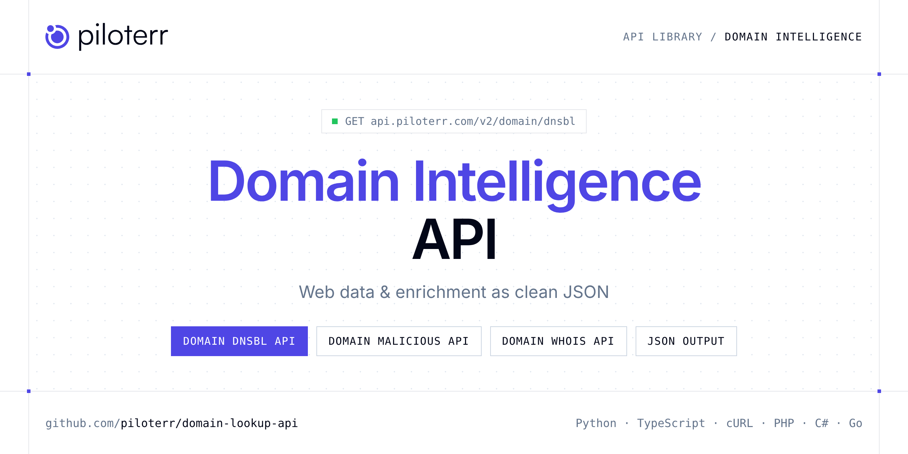

<p align="center">
  <a href="https://www.piloterr.com"></a>
</p>

# Domain Intelligence API

[](https://discord.gg/CFj3ph8aHU) [](https://app.piloterr.com) [](https://app.piloterr.com/openapi) [](LICENSE)

The **Piloterr Domain Intelligence API** lets you extract public data from Domain Intelligence as **clean, structured JSON** — no proxies, headless browsers or HTML parsing to maintain. Endpoints available in production:

- **Domain DNSBL API** — Check if a domain or IP address is listed in DNS-based blacklists (DNSBL), with detailed provider-level detection and category information.
- **Domain Malicious API** — Check if a domain or IP address has been flagged as malicious across multiple threat intelligence feeds, with source attribution.
- **Domain Whois API** — Retrieve WHOIS registration data for any domain, including registration dates, registrar details, name servers, and contact information.

Use it to render, unlock, crawl or enrich any website or domain without running your own scraping infrastructure.

| Endpoint | Path | Credits | What you get |
|---|---|---|---|
| [Domain DNSBL API](#domain-dnsbl-api) | `/v2/domain/dnsbl` | 1 | Check if a domain or IP address is listed in DNS-based blacklists (DNSBL), with detailed provider-level detection and category information. |
| [Domain Malicious API](#domain-malicious-api) | `/v2/domain/malicious` | 1 | Check if a domain or IP address has been flagged as malicious across multiple threat intelligence feeds, with source attribution. |
| [Domain Whois API](#domain-whois-api) | `/v2/domain/whois` | 1 | Retrieve WHOIS registration data for any domain, including registration dates, registrar details, name servers, and contact information. |

## Table of contents

- [How it works](#how-it-works)
- [Domain DNSBL API](#domain-dnsbl-api)
- [Domain Malicious API](#domain-malicious-api)
- [Domain Whois API](#domain-whois-api)
- [Code examples in other languages](#code-examples-in-other-languages)
- [Practical use cases](#practical-use-cases)
- [Why Piloterr?](#why-piloterr)
- [FAQ](#faq)
- [Related scrapers](#related-scrapers)
- [Support](#support)

## How it works

1. **Create a free Piloterr account** and copy your API key from the [dashboard](https://app.piloterr.com).
2. **Send a `GET` (or `POST`) request** to `https://api.piloterr.com/v2/...` with the header `x-api-key: YOUR_API_KEY`.
3. **Receive structured JSON** — Piloterr handles rendering, proxies, retries and parsing.

```bash
export PILOTERR_API_KEY="your-api-key"
pip install requests        # Python
# TypeScript: Node.js 18+ (native fetch), run with `npx tsx file.ts`
```

> Every endpoint accepts both `GET` (query string) and `POST` (JSON body with the same fields).

## Domain DNSBL API

Check if a domain or IP address is listed in DNS-based blacklists (DNSBL), with detailed provider-level detection and category information.

`GET | POST https://api.piloterr.com/v2/domain/dnsbl` · **1 credit per request** · [Full reference](https://app.piloterr.com/openapi)

### Request parameters

| Parameter | Type | Required | Description |
|---|---|---|---|
| `query` | string | ✅ | A domain name or IP address to check against DNS-based blacklists (DNSBL). |

### Python example

```python
import json
import os
import requests

response = requests.get(
    "https://api.piloterr.com/v2/domain/dnsbl",
    headers={"x-api-key": os.environ["PILOTERR_API_KEY"]},
    params={
        "query": "185.122.10.10",
    },
    timeout=120,
)
response.raise_for_status()
data = response.json()

print(json.dumps(data, indent=2, ensure_ascii=False)[:2000])
```

### TypeScript example

```typescript
type DomainDnsbl = {
  address?: string;
  detected?: {
    count?: number;
    providers?: string[];
    categories?: {
      "dbl.spamhaus.org"?: string[];
      "peer.asn.cymru.com"?: string[];
      "origin.asn.cymru.com"?: string[];
      "spambot.bls.digibase.ca"?: string[];
      "abuse-contacts.abusix.org"?: string[];
    };
  };
  providers?: {
    failed?: string[];
    domains?: string[];
    failed_count?: number;
    domains_count?: number;
  };
  blacklisted?: boolean;
};

const params = new URLSearchParams({
  "query": "185.122.10.10",
});

const response = await fetch(`https://api.piloterr.com/v2/domain/dnsbl?${params}`, {
  headers: { "x-api-key": process.env.PILOTERR_API_KEY! },
});
if (!response.ok) throw new Error(`Piloterr error ${response.status}: ${await response.text()}`);

const data = (await response.json()) as DomainDnsbl;

console.log(JSON.stringify(data, null, 2).slice(0, 2000));
```

<details>
<summary><b>POST variant</b></summary>

```http
POST https://api.piloterr.com/v2/domain/dnsbl
x-api-key: YOUR_API_KEY
Content-Type: application/json

{"query": "185.122.10.10"}
```
</details>

### Output example

Example response from the API reference, abridged — real values depend on the page you scrape.

```json
{
  "address": "185.122.xx.xx",
  "detected": {
    "count": 5,
    "providers": [
      "dbl.spamhaus.org",
      "spambot.bls.digibase.ca"
    ],
    "categories": {
      "dbl.spamhaus.org": [
        "unknown"
      ],
      "peer.asn.cymru.com": [
        "unknown"
      ],
      "origin.asn.cymru.com": [
        "unknown"
      ],
      "spambot.bls.digibase.ca": [
        "unknown"
      ],
      "abuse-contacts.abusix.org": [
        "unknown"
      ]
    }
  },
  "providers": {
    "failed": [
      "list.bbfh.org",
      "dnsbl.darklist.de"
    ],
    "domains": [
      "dbl.spamhaus.org",
      "spambot.bls.digibase.ca"
    ],
    "failed_count": 23,
    "domains_count": 271
  },
  "blacklisted": true
}
```

### Response fields

| Field | Type | Description |
|---|---|---|
| `address` | string |  |
| `detected` | object |  |
| `detected.count` | integer |  |
| `detected.providers` | string[] |  |
| `detected.categories` | object |  |
| `providers` | object |  |
| `providers.failed` | string[] |  |
| `providers.domains` | string[] |  |
| `providers.failed_count` | integer |  |
| `providers.domains_count` | integer |  |
| `blacklisted` | boolean |  |

## Domain Malicious API

Check if a domain or IP address has been flagged as malicious across multiple threat intelligence feeds, with source attribution.

`GET | POST https://api.piloterr.com/v2/domain/malicious` · **1 credit per request** · [Full reference](https://app.piloterr.com/openapi)

### Request parameters

| Parameter | Type | Required | Description |
|---|---|---|---|
| `query` | string | ✅ | A domain name or IP address to check for malicious activity across multiple threat intelligence sources. |

### Python example

```python
import json
import os
import requests

response = requests.get(
    "https://api.piloterr.com/v2/domain/malicious",
    headers={"x-api-key": os.environ["PILOTERR_API_KEY"]},
    params={
        "query": "197.33.189.70",
    },
    timeout=120,
)
response.raise_for_status()
data = response.json()

print(json.dumps(data, indent=2, ensure_ascii=False)[:2000])
```

### TypeScript example

```typescript
type DomainMalicious = {
  sources?: {
    url?: string;
    name?: string;
    type?: string;
  }[];
  malicious?: boolean;
};

const params = new URLSearchParams({
  "query": "197.33.189.70",
});

const response = await fetch(`https://api.piloterr.com/v2/domain/malicious?${params}`, {
  headers: { "x-api-key": process.env.PILOTERR_API_KEY! },
});
if (!response.ok) throw new Error(`Piloterr error ${response.status}: ${await response.text()}`);

const data = (await response.json()) as DomainMalicious;

console.log(JSON.stringify(data, null, 2).slice(0, 2000));
```

<details>
<summary><b>POST variant</b></summary>

```http
POST https://api.piloterr.com/v2/domain/malicious
x-api-key: YOUR_API_KEY
Content-Type: application/json

{"query": "197.33.189.70"}
```
</details>

### Output example

Example response from the API reference, abridged — real values depend on the page you scrape.

```json
{
  "sources": [
    {
      "url": "https://raw.githubusercontent.com/duggytuxy/malicious_ip_addresses/main/blacklist_ips_for_fortinet_firewall_ab.txt",
      "name": "Fortinet Firewall AB",
      "type": "ip"
    },
    {
      "url": "https://raw.githubusercontent.com/duggytuxy/malicious_ip_addresses/main/botnets_zombies_scanner_spam_ips.txt",
      "name": "Botnets, Zombies, Scanner, Spam IPs",
      "type": "ip"
    }
  ],
  "malicious": true
}
```

### Response fields

| Field | Type | Description |
|---|---|---|
| `sources[]` | object[] |  |
| `sources[].url` | string |  |
| `sources[].name` | string |  |
| `sources[].type` | string |  |
| `malicious` | boolean |  |

## Domain Whois API

Retrieve WHOIS registration data for any domain, including registration dates, registrar details, name servers, and contact information.

`GET | POST https://api.piloterr.com/v2/domain/whois` · **1 credit per request** · [Full reference](https://app.piloterr.com/openapi)

### Request parameters

| Parameter | Type | Required | Description |
|---|---|---|---|
| `query` | string | ✅ | A domain name for which you want to retrieve WHOIS registration information. |

### Python example

```python
import json
import os
import requests

response = requests.get(
    "https://api.piloterr.com/v2/domain/whois",
    headers={"x-api-key": os.environ["PILOTERR_API_KEY"]},
    params={
        "query": "piloterr.com",
    },
    timeout=120,
)
response.raise_for_status()
data = response.json()

print(json.dumps(data, indent=2, ensure_ascii=False)[:2000])
```

### TypeScript example

```typescript
type DomainWhois = {
  domain?: {
    id?: string;
    name?: string;
    domain?: string;
    status?: string[];
    punycode?: string;
    extension?: string;
    created_date?: string;
    name_servers?: string[];
    updated_date?: string;
    whois_server?: string;
    expiration_date?: string;
    created_date_in_time?: string;
    updated_date_in_time?: string;
    expiration_date_in_time?: string;
  };
  registrar?: {
    id?: string;
    name?: string;
    email?: string;
    phone?: string;
    referral_url?: string;
  };
  technical?: {
    fax?: string;
    city?: string;
    name?: string;
    email?: string;
    phone?: string;
    street?: string;
    country?: string;
    organization?: string;
  };
  registrant?: {
    fax?: string;
    city?: string;
    name?: string;
    email?: string;
    phone?: string;
    street?: string;
    country?: string;
  };
  administrative?: {
    fax?: string;
    city?: string;
    name?: string;
    email?: string;
    phone?: string;
    country?: string;
    organization?: string;
  };
};

const params = new URLSearchParams({
  "query": "piloterr.com",
});

const response = await fetch(`https://api.piloterr.com/v2/domain/whois?${params}`, {
  headers: { "x-api-key": process.env.PILOTERR_API_KEY! },
});
if (!response.ok) throw new Error(`Piloterr error ${response.status}: ${await response.text()}`);

const data = (await response.json()) as DomainWhois;

console.log(JSON.stringify(data, null, 2).slice(0, 2000));
```

<details>
<summary><b>POST variant</b></summary>

```http
POST https://api.piloterr.com/v2/domain/whois
x-api-key: YOUR_API_KEY
Content-Type: application/json

{"query": "piloterr.com"}
```
</details>

### Output example

Example response from the API reference, abridged — real values depend on the page you scrape.

```json
{
  "domain": {
    "id": "2236981934_DOMAIN_COM-VRSN",
    "name": "piloterr",
    "domain": "piloterr.com",
    "status": [
      "clientdeleteprohibited",
      "clienttransferprohibited"
    ],
    "punycode": "piloterr.com",
    "extension": "com",
    "created_date": "2018-03-08T23:08:14Z",
    "name_servers": [
      "cruz.ns.cloudflare.com",
      "fred.ns.cloudflare.com"
    ],
    "updated_date": "2023-06-22T07:40:14Z",
    "whois_server": "whois.ovh.com",
    "expiration_date": "2030-03-08T23:08:14Z",
    "created_date_in_time": "2018-03-08T23:08:14Z",
    "updated_date_in_time": "2023-06-22T07:40:14Z",
    "expiration_date_in_time": "2030-03-08T23:08:14Z"
  },
  "registrar": {
    "id": "433",
    "name": "OVH sas",
    "email": "example",
    "phone": "example",
    "referral_url": "https://www.ovh.com"
  },
  "technical": {
    "fax": "REDACTED FOR PRIVACY",
    "city": "REDACTED FOR PRIVACY",
    "name": "REDACTED FOR PRIVACY",
    "email": "example",
    "phone": "example",
    "street": "REDACTED FOR PRIVACY",
    "country": "REDACTED FOR PRIVACY",
    "organization": "REDACTED FOR PRIVACY"
  },
  "registrant": {
    "fax": "REDACTED FOR PRIVACY",
    "city": "REDACTED FOR PRIVACY",
    "name": "REDACTED FOR PRIVACY",
    "email": "example",
    "phone": "example",
    "street": "REDACTED FOR PRIVACY",
    "country": "FR"
  },
  "administrative": {
    "fax": "REDACTED FOR PRIVACY",
    "city": "REDACTED FOR PRIVACY",
    "name": "REDACTED FOR PRIVACY",
    "email": "example",
    "phone": "example",
    "country": "REDACTED FOR PRIVACY",
    "organization": "REDACTED FOR PRIVACY"
  }
}
```

### Response fields

| Field | Type | Description |
|---|---|---|
| `domain` | object |  |
| `domain.id` | string |  |
| `domain.name` | string |  |
| `domain.domain` | string |  |
| `domain.status` | string[] |  |
| `domain.punycode` | string |  |
| `domain.extension` | string |  |
| `domain.created_date` | string |  |
| `domain.name_servers` | string[] |  |
| `domain.updated_date` | string |  |
| `domain.whois_server` | string |  |
| `domain.expiration_date` | string |  |
| `domain.created_date_in_time` | string |  |
| `domain.updated_date_in_time` | string |  |
| `domain.expiration_date_in_time` | string |  |
| `registrar` | object |  |
| `registrar.id` | string |  |
| `registrar.name` | string |  |
| `registrar.email` | string |  |
| `registrar.phone` | string |  |
| `registrar.referral_url` | string |  |
| `technical` | object |  |
| `technical.fax` | string |  |
| `technical.city` | string |  |
| `technical.name` | string |  |

## Code examples in other languages

Ready-to-run examples live in the [`examples/`](examples) folder. Each one reads your key from the `PILOTERR_API_KEY` environment variable.

| Language | Domain DNSBL | Domain Malicious | Domain Whois |
|---|---|---|---|
| cURL (Bash) | [`dnsbl`](examples/curl/dnsbl.sh) | [`malicious`](examples/curl/malicious.sh) | [`whois`](examples/curl/whois.sh) |
| PHP | [`dnsbl`](examples/php/dnsbl.php) | [`malicious`](examples/php/malicious.php) | [`whois`](examples/php/whois.php) |
| C# | [`dnsbl`](examples/csharp/Dnsbl.cs) | [`malicious`](examples/csharp/Malicious.cs) | [`whois`](examples/csharp/Whois.cs) |
| Go | [`dnsbl`](examples/go/dnsbl.go) | [`malicious`](examples/go/malicious.go) | [`whois`](examples/go/whois.go) |
| Java | [`dnsbl`](examples/java/DnsblExample.java) | [`malicious`](examples/java/MaliciousExample.java) | [`whois`](examples/java/WhoisExample.java) |
| Ruby | [`dnsbl`](examples/ruby/dnsbl.rb) | [`malicious`](examples/ruby/malicious.rb) | [`whois`](examples/ruby/whois.rb) |
| Node.js | [`dnsbl`](examples/nodejs/dnsbl.mjs) | [`malicious`](examples/nodejs/malicious.mjs) | [`whois`](examples/nodejs/whois.mjs) |

## Practical use cases

- **Scraping any website** — Render JavaScript and unlock protected pages through one API.
- **Data enrichment** — Enrich domains, emails and companies in your pipelines.
- **Security & compliance** — Check domains against blocklists and threat sources.
- **Lead qualification** — Verify contacts and detect website technologies.
- **Automation** — Plug results into ETL, no-code tools and AI agents.

## Why Piloterr?

- **No infrastructure** — no proxies, headless browsers or CAPTCHA solving to run yourself.
- **Structured JSON** — stable, documented fields instead of brittle HTML selectors.
- **Pay per request** — transparent credit cost per endpoint, failed requests are retried for you.
- **One API key, hundreds of sources** — Domain Intelligence plus many other e-commerce, search and company data endpoints in the [Piloterr library](https://www.piloterr.com/library).
- **Any language** — plain HTTPS + JSON, with examples for Python, TypeScript, cURL, PHP, C#, Go, Java, Ruby and Node.js.

## FAQ

### Is it legal to scrape Domain Intelligence?

Collecting publicly available data is generally allowed in many jurisdictions, but rules depend on your country, the data you collect and how you use it. Avoid personal data unless you have a lawful basis, respect the website's terms where they apply, and get legal advice for your specific use case. This is not legal advice.

### Do I need proxies or a headless browser?

No. Piloterr handles rendering, proxy rotation and retries on its side. You only send an HTTPS request with your `x-api-key` header and receive JSON.

### How much does a request cost?

Credits per call: `/v2/domain/dnsbl` **1**, `/v2/domain/malicious` **1**, `/v2/domain/whois` **1**. See the [Piloterr website](https://www.piloterr.com) for plans.

### What data does the Domain Intelligence API return?

Each endpoint returns structured JSON: **Domain DNSBL** — `address`, `detected`, `detected.count`, `detected.providers`, `detected.categories`, `providers`; **Domain Malicious** — `sources[]`, `sources[].url`, `sources[].name`, `sources[].type`, `malicious`; **Domain Whois** — `domain`, `domain.id`, `domain.name`, `domain.domain`, `domain.status`, `domain.punycode`.

### Which languages are supported?

Any language that can make an HTTP request. This README shows Python and TypeScript; the [`examples/`](examples) folder contains cURL, PHP, C#, Go, Java, Ruby and Node.js.

## Related scrapers

- [Email Finder & Verifier API](https://github.com/piloterr/email-finder-api)
- [Website Scraping API](https://github.com/piloterr/website-scraper-api)
- [All Piloterr scrapers on GitHub](https://github.com/piloterr)

## Support

- 💬 Join the [Piloterr Discord](https://discord.gg/CFj3ph8aHU) to ask questions and share what you build.
- 📚 Browse the [API reference (OpenAPI)](https://app.piloterr.com/openapi) and the [Piloterr library](https://www.piloterr.com/library).
- 🔑 [Get your API key](https://app.piloterr.com).

---

<p align="center">
  <a href="https://www.piloterr.com">
    <picture>
      <source media="(prefers-color-scheme: dark)" srcset="images/logo-dark.svg">
      
    </picture>
  </a>
  <br>
  <sub>Built by <a href="https://www.piloterr.com">Piloterr</a> — web scraping APIs for e-commerce, search, real estate and more, one API key.</sub>
</p>

<sub>Domain Intelligence is a trademark of its respective owner. This repository is not affiliated with or endorsed by Domain Intelligence. Examples are released under the MIT license.</sub>
